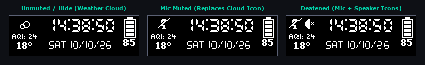

# 📜 Changelog — SteelSeries OLED & RGB Hub

Complete version history for **SteelSeries OLED & RGB Hub**, developed and expanded by **[gizmous](https://github.com/Gizmous100)** on top of the original **[OLED Customizer](https://github.com/0z-zy/OLED_Customizer)** created by **[0z-zy](https://github.com/0z-zy)** (inspired by **[SteelSeries-Spotify-Linker](https://github.com/Firewee/SteelSeries-Spotify-Linker)** by **[Firewee](https://github.com/Firewee)**).

**Project Versioning Policy:**
- **`+0.10` (`Major`)** — brand-new major functional modules (e.g., `v1.10`, `v1.20`, `v1.30`, `v1.40`).
- **`+0.01` (`Fix / Feature Upgrade`)** — bug fixes, architectural optimizations, and enhancements to existing modules (e.g., `v1.41` – `v1.63`).

---

---

## [`v1.65`] — 2026-10-30 — Wireless Headset HID Discovery Hardening & Dual-Device AFK Blackout (Keyboard & Mouse)
### ✨ Fixer (`+0.01`)
- **Wireless Headset HID Discovery Hardening (`src/HIDListener.py`):**
  - **Root Cause Resolution**: Resolved an issue where the headset battery indicator on the OLED clock disappeared after startup or standby. Because SteelSeries keyboards (e.g. Apex 7, `PID 0x1612`) and mice share the SteelSeries vendor ID (`VID 0x1038`), temporary unresponsiveness or sleep of the wireless headset dongle (`PID 0x22a1`) caused the fallback discovery algorithm to latch onto the Apex 7 keyboard (`PID 0x1612`) as a "headset" endpoint. Once connected to the keyboard, the reader thread never errored out or re-scanned, locking the battery monitor into a dead state.
  - **Strict Candidate Filtering**: Added hardware PID validation in registry enumeration and candidate priority: all non-headset SteelSeries devices (`PID 0x16xx` keyboards, `PID 0x18xx` mice, and accessories) are strictly excluded from headset discovery.
  - **Instant Headset Latch & Priority Return**: Enabled direct short-circuit return when `MI_03` is discovered on SteelSeries headsets with read/write access, mirroring the `COL05` pattern for Cloud III.
  - **Dynamic Reconnection & Error Recovery**: If `ReadFile` or `CreateFileW` encounters a disconnection error (error codes 2, 3, 6, 55, 1167), `self.device_path` is immediately set to `None`, triggering an automatic background re-scan that seamlessly reconnects as soon as the headset transceiver becomes available.
  - **Instant Initial Battery Query**: Added an immediate `query_battery()` dispatch upon connection in `_listen_loop`, eliminating the initial 5-to-15 second delay before the battery level first appears on the OLED display.
- **Unified Dual-Device AFK Blackout (`src/SteelSeriesAPI.py`):**
  - **Root Cause Resolution**: Resolved an issue where the SteelSeries Apex 7 keyboard backlight remained illuminated upon entering AFK mode even though the mouse and OLED screen properly turned off. In GameSense 3, handlers using `device-type: rgb-per-key-zones` with `zone: all` require `mode: bitmap` rather than `mode: color`; when `mode: color` was passed, the Lisp engine marked the keyboard device as handled without applying LED colors, simultaneously preventing the secondary `device-type: keyboard` handler from executing.
  - **Dual Native Engine Configuration Blackout (`_blackout_device_configs`)**: Expanded the encrypted REST API deployment (`/configuration/<cid>/forceDeploy`) beyond mice to all connected SteelSeries keyboards. Active keyboard configurations have `global_brightness` set to 0, `lighting_config` (foundation, idle, and reactive graphics) cleared, individual zone colors set to `[0, 0, 0]`, `idle_mode_dimmer` zeroed, and `lock_key_color` zeroed.
  - **Bitmap Event Fallback**: Corrected GameSense `LIGHTING` handler on `rgb-per-key-zones` to use `mode: bitmap` with a full 132-key zero matrix (`[[0, 0, 0]] * 132`) alongside generic keyboard color handlers.
  - **Symmetric Exiting & Restoration (`_restore_device_configs`)**: Waking from AFK seamlessly restores original configuration structures for both keyboard and mouse, followed by `_redeploy_engine_active_configs()` to maintain complete profile integrity.

## [`v1.64`] — 2026-10-29 — AFK SSL Module Import & Universal Wake-Up Guard (Reliable Wake via Windows Input Fallback)
### ✨ Fixer (`+0.01`)
- **AFK SSL Module Import & Engine API Reliability (`src/SteelSeriesAPI.py`):**
  - **Module-Level Imports**: Added top-level `import ssl` and `import urllib.request` to `src/SteelSeriesAPI.py`. Previously, these libraries were only imported locally inside `_redeploy_active_engine_configs()`, triggering `NameError: name 'ssl' is not defined` when `_blackout_mouse_configs()` or `_restore_mouse_configs()` executed during AFK transitions.
  - **Flawless Mouse Blackout**: With module-level imports restored, the encrypted REST API calls (`/configuration/<cid>` and `/configuration/<cid>/forceDeploy`) successfully zero out `global_brightness` and clear RGB sequences on connected mice (e.g. Rival 5), achieving complete blackout `[0, 0, 0]` without errors.
- **Universal AFK Wake-Up Fallback Guard (`src/DisplayManager.py`):**
  - **Session & Coordinate Independence**: Added a fallback check using kernel-level Win32 `GetLastInputInfo`:
    `elif (win_idle_ms < 500) and (last_input_tick > self._afk_baseline_input_tick) and ((now_ms - self._afk_settled_time) > 1000)`
    This ensures that any genuine user input (mouse move, click, or keystroke) immediately wakes the application from AFK even when cursor coordinates report `(0, 0)` (e.g., monitor DP/DVI power-off, non-interactive stations, or fullscreen exclusive mode) or when low-level hooks are bypassed.

## [`v1.63`] — 2026-10-29 — AFK Native Mouse Blackout & GameSense Isolation (Eliminated Rival 5 Factory Orange Fallback)
### ✨ Fixer (`+0.01`)
- **AFK Native Mouse Blackout & GameSense Isolation (`src/SteelSeriesAPI.py`, `src/DisplayManager.py`):**
  - **Root Cause Resolution**: Resolved an issue where the SteelSeries Rival 5 (and other multi-zone composite mice) illuminated in bright SteelSeries factory orange (`#FC4E02` / `[255, 24, 0]`) upon entering AFK mode instead of turning completely black (`[0, 0, 0]`).
  - **GameSense Composite Zone Exclusion**: SteelSeries GG Engine has no GameSense Lisp dispatcher support for 10-zone composite mice. When GameSense bound composite/zoned handlers, `generic-initializer.lsp` invoked `use-zone:` on the Rival 5, placing it into GameSense control while lacking handlers to paint its 10 addressable LED segments, leaving it permanently frozen on the factory orange fallback.
  - **Separation of Concerns**: Restructured `_bind_lighting_event()` to bind GameSense `LIGHTING` exclusively on keyboard zones (`rgb-per-key-zones` and `keyboard`), guaranteeing that GameSense never claims mouse composite zones.
  - **Direct Native Engine Configuration Deployment**: Implemented `_blackout_mouse_configs()` and `_restore_mouse_configs()` using SteelSeries GG Engine's encrypted REST API (`/configuration/<cid>/forceDeploy`). During AFK mode, mouse `global_brightness` is set to 0, `default_lighting_enabled` to 0, and color sequences are zeroed, achieving true 100% hardware blackout (`[0, 0, 0]`) across all 10 Rival 5 zones.
  - **Instant Clean Wake-Up Restoration**: Exiting AFK mode cleanly restores original mouse profile settings (e.g. user-configured blue `[27, 54, 207]`) via `forceDeploy` and destroys the keyboard's temporary GameSense sandbox, ensuring seamless profile continuity without mouse lockups.
  - **Render Loop Rate-Limit Guard**: Added a 3.0-second attempt cooldown and state guard to `_sync_lighting_state()` in `DisplayManager`, eliminating 10 FPS retry loops and preventing `HTTP 429 Too Many Requests` errors.

## [`v1.62`] — 2026-10-27 — AFK False Wake-Up Elimination (Optical Sensor Deadband, Screen Sleep Guard & Precise Input Tracking)
### ✨ Fixer (`+0.01`)
- **AFK False Wake-Up Elimination (`src/DisplayManager.py`):**
  - Resolved an issue where AFK mode woke up spontaneously after 2–30 seconds due to optical mouse sensor noise and Windows display power-down states.
  - **Mouse Movement Deadband**: Replaced zero-tolerance coordinate comparison (`cur_pos != baseline`) with a 10-pixel Euclidean deadband (`dist_x >= 10 or dist_y >= 10`) for waking from AFK, and a 3-pixel filter during active usage. Optical sensor micro-jitter (1–2 px) on cloth pads/desks no longer triggers false wake-ups.
  - **Display Sleep & `(0, 0)` Guard**: Handled Win32 `GetCursorPos` returning `(0, 0)` with `ERROR_ACCESS_DENIED` (code 5) when monitors enter DP/DVI power-save or UAC secure desktop. Baseline coordinates are safely latched only when coordinates are valid (`!= (0, 0)`), preventing the instant 2-second wake-up loop.
  - **Click/Wheel Only Hook Input**: Updated low-level mouse hook (`_mouse_hook_callback`) to ignore raw `WM_MOUSEMOVE` and only register genuine physical button clicks and wheel turns (`WM_LBUTTONDOWN`, `WM_RBUTTONDOWN`, `WM_MBUTTONDOWN`, `WM_XBUTTONDOWN`, `WM_MOUSEWHEEL`).
  - **Native XInput Gamepad Support**: Added XInput polling in `DisplayManager` so physical gamepad stick/button activity keeps the system awake and wakes from AFK.
  - **Granular Wake Logging**: Replaced generic `woken by user input` with specific diagnostics (`woken by keyboard keypress`, `woken by mouse click/wheel`, `woken by mouse movement (dx=..., dy=...)`, `woken by gamepad activity`).

## [`v1.61`] — 2026-10-23 — Silent Background SteelSeries GG Auto-Launch via `SteelSeriesGGEZ` & `-auto=true`
### ✨ Fixer (`+0.01`)
- **Silent Background SteelSeries GG Launch (`src/utils.py`, `src/DisplayManager.py`, `src/Systray.py`):**
  - Resolved an issue where auto-launching SteelSeries GG on system startup or auto-recovery popped up the main SteelSeries GG GUI dashboard window on the desktop.
  - Updated `find_steelseries_gg_path()` to prioritize `SteelSeriesGGEZ.exe` (SteelSeries' official silent background launcher) before `SteelSeriesGG.exe`.
  - Appended `-auto=true` flag to startup arguments (`-dataPath="C:\ProgramData\SteelSeries\GG" -dbEnv=production -auto=true`), matching the official Windows startup command line.
  - Fixed `launch_process()` Win32 `ShellExecuteW` call so `minimized=True` correctly passes `SW_SHOWMINNOACTIVE` (`7`) instead of hardcoded `SW_SHOWNORMAL` (`1`), keeping the launch fully suppressed in the system tray without stealing user focus.
  - Added `SteelSeriesGGEZ.exe` to process kill and running checks during auto-recovery and database backup restoration.

## [`v1.60`] — 2026-10-21 — Native-Styled Profile Overlay Restricted to GG Preconfigs & Sub-100ms Instant Dispatch
### ✨ Fixer (`+0.01`)
- **Native-Styled Profile Overlay Restricted Exclusively to GG Preconfigs (`src/ProfileOverlay.py`, `src/DisplayManager.py`):**
  - Resolved double-notification collisions on onboard hardware profile slots (e.g., `Desktop` on Slot 1, `Black Desert` on Slot 2, `Config 3..5` on Slots 3..5): the background monitor now identifies Apex 7's `onboard_profile_slot` (`0..4`) and suppresses our software overlay so only the keyboard MCU's built-in OSD animation appears.
  - Software preconfigs (game profiles with `onboard_profile_slot == -1`, such as *Battlefield 6* or *World of Warcraft*) that lack hardware OSD notifications cleanly trigger our notification.
  - Redesigned the visual style to match the keyboard's native built-in OSD: eliminated outer border lines, inverted pill boxes, and divider lines in favor of a minimalist, high-contrast black layout with centered `PROFILE` header and bold game title.
  - Optimized the polling loop from 500ms down to **80ms** with instant synchronous frame dispatch upon detection, minimizing the window where SteelSeries Engine's deployed background GIF is visible.

## [`v1.59`] — 2026-10-21 — Real-Time Profile Switch Detection & OLED Overlay Fixer for GG Games and Preconfigs
### ✨ Fixer (`+0.01`)
- **Real-Time Profile Switch Detection & OLED Overlay Fixer (`src/ProfileOverlay.py`, `src/DisplayManager.py`):**
  - Added real-time background tracking for SteelSeries GG active game loadouts (`/v1/loadouts/active`) and individual connected device configurations (`/v1/connectedDevices`).
  - When switching to games or preconfigs in GG (such as *Battlefield 6*, *World of Warcraft*, etc. which have `onboard_profile_slot == -1` and produce no hardware firmware animation), an elegant, centered 128×40 OLED overlay is displayed instantly with an inverted device badge and clean divider line.
  - Added event deduplication and 10 FPS continuous frame streaming during the overlay window to guarantee smooth, persistent visibility.
  - Fully configurable in Settings under **Display → 🎯 Profile Switch Overlay** with customizable display duration (`profile_switch_display_time`) and live test button (`🎯 Test Profile Overlay Now`).

---

## [`v1.58`] — 2026-10-21 — Active Profile Priority in Engine Redeploy & Game Auto-Switch Safeguard
### ✨ Bug Fixes & Improvements (`+0.01`)
- **Active Profile Priority in Engine Configuration Redeploy (`src/SteelSeriesAPI.py`):**
  - Root-caused an issue where exiting AFK mode or reinitializing SteelSeries GG Engine illumination erroneously restored stale desktop configurations (e.g. `Desktop` on Apex 7 or `Default` on Rival 5) instead of the user's active game profile (such as `Black Desert`).
  - Corrected configuration candidate selection priority in `_redeploy_engine_active_configs()`: `active == 1` candidate selection now strictly precedes fallback `last_deployed == 1` matching. When a game profile is triggered or selected in SteelSeries GG, Engine assigns `active: 1` immediately, guaranteeing `POST /configuration/<id>/forceDeploy` always redeploys the active game profile rather than reverting to previous desktop hardware profiles.

---

## [`v1.57`] — 2026-10-12 — Apex 7 Onboard Hardware `idle_timeout` Override During Mouse Activity & `GetCursorPos` Tracking
### ✨ Bug Fixes & Improvements (`+0.01`)
- **Apex 7 Onboard Hardware `idle_timeout` Override (`src/SteelSeriesAPI.py`):**
  - Root-caused why the **Apex 7** keyboard turned off its own RGB LEDs after 5 minutes of using only the mouse even when `SteelSeries OLED & RGB Hub` stayed in active (`AFK = False`) mode: SteelSeries GG Engine's default keyboard profile (`Config 1`) programs an onboard hardware `idle_timeout` (`{"timeout": 300000}` = 5 minutes, `idle_default_color: {r:0, g:0, b:0}`) directly into the keyboard's USB microcontroller, which only counts physical keypresses on the keyboard and is completely blind to mouse movement in Windows.
  - Updated `_redeploy_engine_active_configs()` to inspect the active Engine configuration via `GET /configuration/<id>` and automatically set `"idle_timeout": {"timeout": 0}` (`Never`) via `PUT /configuration/<id>` before calling `POST /configuration/<id>/forceDeploy`. This ensures the keyboard never turns off on its own while the user is moving the mouse, delegating AFK blackout uniformly to `SteelSeries OLED & RGB Hub`.
- **Triple-Redundant Mouse & Keyboard Activity Tracking (`src/DisplayManager.py`, `src/utils.py`):**
  - Added `get_cursor_pos()` (`user32.GetCursorPos`) cursor coordinate tracking alongside `GetLastInputInfo()` and low-level `WH_MOUSE_LL` / `WH_KEYBOARD_LL` hooks (`_last_hook_input_ms`), taking `min(win_idle_ms, hook_idle_ms, cursor_idle_ms)` so any physical mouse movement, click, or keypress reliably resets the AFK timer and wakes from AFK.

---

## [`v1.56`] — 2026-10-12 — Isolated AFK RGB GameSense Architecture (Rival 5 Orange Fix), Persistent AFK OLED Blank & One-Click AFK Test
### ✨ Bug Fixes & Improvements (`+0.01`)
- **Isolated Two-Game GameSense Architecture — Permanent Rival 5 Factory Orange (`#FC4E02`) Fix (`src/SteelSeriesAPI.py`):**
  - Root-caused a SteelSeries Engine Lisp VM bug in `user-config.lsp` (`clear-event-zones-at-level`): while `/remove_game_event` clears per-key keyboard zones (`clear-event-per-key-zones-at-level`), SteelSeries Engine has no `clear-event-composite-zones-at-level` function. Once `LIGHTING` was ever bound on `STEELSERIES_OLED_HUB`, Rival 5's `rgb-10-zone` composite zones remained permanently cached in `STEELSERIES_OLED_HUB`'s sandbox (`get-composite-zones-in-use`), so the very next OLED `UPDATE` frame after `/stop_game` triggered `generic-initializer.lsp` (`initialize:`) to reclaim Rival 5's RGB zones and overwrite its steady blue profile with GameSense factory orange (`#FC4E02`).
  - Separated OLED display updates (`STEELSERIES_OLED_HUB` -> `UPDATE`) and AFK RGB blackout (`STEELSERIES_AFK_RGB` -> `LIGHTING`) into two completely independent GameSense games.
  - On startup (`register_game`), `STEELSERIES_OLED_HUB` is purged via `/remove_game` and registered strictly with the `screened-128x40` `UPDATE` handler, then primed with one frame and followed by `_redeploy_engine_active_configs()`.
  - When entering AFK (`set_lighting(False)`), `STEELSERIES_AFK_RGB` is dynamically registered and bound to black out keyboard and mouse RGB (`[0, 0, 0]`), and kept alive via `/game_heartbeat`.
  - When waking from AFK (`release_lighting_to_gg()`) or exiting the application (`remove_game()`), `STEELSERIES_AFK_RGB` is completely destroyed via `/remove_game_event` + `/stop_game` + `/remove_game`, followed by a `0.12s` settle delay and `POST /configuration/<id>/forceDeploy` on both keyboard and mouse.
- **Persistent OLED Blackout During AFK Mode & Immediate Blank Frame Verification (`src/DisplayManager.py`, `src/Systray.py`):**
  - Fixed a bug where `_last_sent_frame = [0] * 640` was set unconditionally even if `send_frame()` returned `False` (leaving the clock frozen on the OLED screen during AFK), and where `screener.lsp` (`deinitialize:` -> `update-screen-to-background:`) woke the OLED display back up after 60 seconds of AFK when no `UPDATE` events were sent.
  - Added immediate `[0] * 640` frame dispatch upon entering AFK, checked `send_frame()` return status before caching `_last_sent_frame`, and kept resending `[0] * 640` every `2.0s` during AFK so the OLED screen stays completely off for the entire duration of AFK mode.
  - Added clean `steelseries_api.remove_game()` execution inside `DisplayManager.shutdown()` so closing the app never triggers a delayed 60-second GameSense `deinitializer-proc` reset on the mouse.
- **One-Click AFK Test Button & Low-Level Hook Wake Fallback (`src/SettingsWindow.py`, `src/DisplayManager.py`):**
  - Added a **`🌙 Test AFK Mode Now (1.5s delay)`** button in **Settings → 💤 AFK Mode** (`trigger_afk_test()`) and support for decimal `Idle Timeout (minutes)` values (e.g., `0.2` min) so users can test OLED and RGB AFK blackout with a single click.
  - Supplemented `GetLastInputInfo` wake detection with direct physical mouse (`WH_MOUSE_LL`, `LLMHF_INJECTED == 0`) and keyboard (`WH_KEYBOARD_LL`, `LLKHF_INJECTED == 0`) hook timestamps (`_last_hook_input_ms`).

---

## [`v1.55`] — 2026-10-12 — Mouse RGB AFK Blackout & Reliable Input Wake Fix
### ✨ Bug Fixes & Improvements (`+0.01`)
- **Mouse RGB AFK Blackout Fix (`src/SteelSeriesAPI.py`):**
  - Removed premature `send_data("/stop_game")` inside `_bind_lighting_event()` which previously stopped the GameSense game right after binding, caused SteelSeries Engine to immediately restore mouse illumination, and triggered phantom Windows input events.
  - Expanded `lighting_handlers` to cover all mouse illumination zones: added `rgb-10-zone` (`all` and `one`..`ten`), `mouse` (`all`, `wheel`, `logo`), `rgb-zoned-device` (`all` and `one`..`ten`), and generic `rgb-1-zone` through `rgb-12-zone` so multi-zone mice (such as **Rival 5**) completely black out alongside keyboard RGB and the OLED screen.
- **Reliable AFK Idle & Mouse Wake Detection (`src/DisplayManager.py`, `src/utils.py`):**
  - Replaced flawed `_effective_idle_start` and relative `raw_idle_ms < _last_raw_idle_ms - 1000` logic (which failed to detect mouse wakeups if `_last_raw_idle_ms` was 0 and falsely triggered AFK during active continuous typing/moving).
  - Implemented direct Windows `GetLastInputInfo` tick tracking (`get_last_input_info()` returning `(dwTime, idle_ms)`) with a 1.5-second settle window upon entering AFK. Any subsequent mouse movement, click, or keystroke updates `dwTime` and immediately wakes the system up, turning the OLED display back on and restoring native SteelSeries GG illumination profiles on both keyboard and mouse.

---

## [`v1.54`] — 2026-10-11 — Show / Hide Mute & Deafen Icons on Clock (Replaces Weather Cloud) & SteelSeries HID Write Guard
### ✨ New Features & Improvements (`+0.01`)
- **Show / Hide Mute & Deafen Icons on Clock (`src/Timer.py`, `src/DisplayManager.py`, `src/SettingsWindow.py`, `src/UserPreferences.py`):**
  - Added a new **`Show Mute / Deafen Icons on Clock (Replaces Weather Cloud)`** toggle (`show_clock_mute_icons`, accessible in both **Settings → Display → 🌦️ Weather & Clock Left Widget** and **Settings → Advanced → 🎙️ Discord Voice & Mute Icons**).
  - When **Show (`ON`)** is enabled and the microphone or speaker is muted/deafened (`OFF`), the top weather-icon slot (`y = 2..13`, where the weather cloud/sun is drawn) displays only the pure **`mic_off.png` and/or `speaker_mute.png` icon(s)** (without `ON`/`OFF` text), while preserving **`AQI` and temperature (`°C`)** directly underneath.
  - When both microphone and speaker are unmuted (`ON`), or when **Hide (`OFF`)** is selected, the top slot renders the normal **weather condition icon (clouds/sun/rain)**.
  - Added a `ToggleSwitch` variable trace (`trace_add("write", ...)`) and live callback so toggling the switch updates both Settings tabs and the keyboard OLED screen immediately in real time.
- **SteelSeries Arctis Nova 7 Mechanical Mute Switch Guard (`src/HIDListener.py`):**
  - Skipped sending HyperX Cloud III HID mute output reports (`_do_hardware_mute`) when connected to SteelSeries headsets (`VID_1038`), as the **Arctis Nova 7** uses a purely mechanical latching earcup mute switch that does not emit or accept USB HID mute packets.

---

## [`v1.53`] — 2026-10-11 — Multimedia Settings Tab & Mock Discord Mode (Local Mute/Deafen OLED Icons)
### ✨ New Features & Improvements (`+0.01`)
- **`🎵 Multimedia` Settings Tab (`src/SettingsWindow.py`):**
  - Renamed the **Spotify** sidebar tab to **`🎵 Multimedia`** and moved **Player Layout Adjustments** (`Scrollbar Margin (px)` and `Text Indentation (px)`) from `Advanced` into `Multimedia` with an explanatory caption for the `Standard` music player style.
- **Mock Discord Mode & Live OLED Mute/Deafen Test (`src/volume.py`, `src/DisplayManager.py`, `src/SettingsWindow.py`, `src/UserPreferences.py`):**
  - Added **`Mock Discord Mode (Local Mute Icons without OAuth)`** (`discord_mock_enabled`, disabled by default) under **Settings → Advanced → 🎙️ Discord Voice & Mute Icons**.
  - Allows the 128×40 OLED overlay to display microphone (`mic_on.png` / `mic_off.png`) and deafen (`speaker_mute.png` + `mic_off.png`) icons and synchronize with global mute hotkeys (`Pause`) and physical headset mute buttons without requiring a Discord Developer OAuth2 application.
  - Added interactive **`🎤 Test Mic Mute on OLED`** and **`🔇 Test Deafen on OLED`** buttons in **Settings → Advanced** with a live status indicator so users can immediately preview and toggle mute/deafen icons on the keyboard OLED screen.
  - Fixed `VolumeOverlay.get_image()` so deafened state (`_discord_deafened`) renders `speaker_mute.png` on the left and `mic_off.png` on the right without the volume bar overlapping the microphone icon, and prioritized the 2.5s volume/mute overlay above the always-on Hardware Monitor.

---

## [`v1.52`] — 2026-10-11 — Settings GUI Tcl/Tk Thread Crash Fix (`tcl86t.dll`) & Switch Alignment
### ✨ Improvements & Fixes (`+0.01`)
- **Persistent Settings UI Thread & Cyclic GC Hardening (`src/SettingsWindow.py`, `src/Systray.py`):**
  - Fixed a fatal Windows crash (`0x80000003` / `Tcl_Panic("Tcl_AsyncDelete: async handler deleted by the wrong thread")` in `tcl86t.dll`) that occurred when Python's cyclic Garbage Collector ran on the Main Thread after a disposable Settings GUI thread had closed.
  - Moved `SettingsGUI` execution onto a single persistent daemon thread (`Settings-UI-Thread`) and added explicit widget/variable reference cleanup plus immediate `gc.collect()` on the owning Tcl/Tk thread upon window close.
  - Updated `_check_updates()` to dispatch `StringVar` updates onto the Tk thread via `root.after(0, ...)`.
- **Dedicated `💤 AFK Mode` Tab & Settings Layout Alignment (`src/SettingsWindow.py`):**
  - Moved the **Idle / AFK Mode** settings into a dedicated **`💤 AFK Mode`** sidebar tab for cleaner navigation.
  - Fixed misaligned and clipped `ToggleSwitch` / `Combobox` / `Entry` controls on rows with long option labels by packing right-side controls before left-side labels, refining typography (`FONT_BODY` 9pt), widening the window to `680×620`, and packing the vertical scrollbar with `before=self.canvas`.
  - Fixed the bottom version/author credit label on the `General` tab (`Version: v1.52...`) being clipped on the left (`ersion(...)`) by adding explicit left alignment (`anchor="w"`, `justify="left"`, `wraplength=420`) and a clean two-line layout.
- **Persistent Settings Window on Save & Startup Task Optimization (`src/SettingsWindow.py`, `src/DisplayManager.py`):**
  - Clicking **SAVE** now applies and persists all settings while keeping the Settings window open (the window closes only when clicking **`×`**).
  - Avoided invoking `set_startup()` (`Register-ScheduledTask`) when the `Run on Start` toggle has not changed, and synced `_last_config_mtime` on save to prevent duplicate config reloads and unnecessary lighting resets.

---

## [`v1.51`] — 2026-10-11 — Disable AFK Mode in Games & Rival 5 Steady Orange (`#FC4E02`) Fix
### ✨ New Features & Fixes (`+0.01`)
- **Disable Idle / AFK Mode During Games (`src/DisplayManager.py`, `src/HardwareMonitor.py`, `src/SettingsWindow.py`, `src/UserPreferences.py`):**
  - Added a new **`Disable Idle / AFK Mode During Games`** toggle (`afk_disable_in_games`, enabled by default) under **Settings → Display → 💤 Idle / AFK Mode**.
  - Added cached fullscreen / borderless-windowed and Direct3D Exclusive Fullscreen (`SHQueryUserNotificationState` / `QUNS_RUNNING_D3D_FULL_SCREEN`) game detection (`HardwareMonitor.is_fullscreen_game_active()`, decoupled from `auto_hw_monitor_game`) so the OLED display, keyboard RGB, and mouse RGB never turn off during long cutscenes or controller gameplay.
  - Automatically resets the effective idle start timestamp while a game is active in the foreground so exiting or Alt-Tabbing from a game does not immediately trigger AFK blackout.
- **Rival 5 Steady Orange (`#FC4E02`) GameSense Cache & Reset Fix (`src/SteelSeriesAPI.py`):**
  - Fixed a SteelSeries Engine GameSense Lisp VM quirk (`standard-boilerplate.lsp` / `rival-5.lsp`) where removing `LIGHTING` without `/stop_game` left `zones-in-use-cache` populated (`TYPE-lighting-STEELSERIES_OLED_HUB: 10`), causing `ReinitializeActiveGames` to repeatedly stop mouse color sequences and write `gamesense_orange_rgb` (`#FC4E02`).
  - Added automatic Engine HTTPS active configuration redeployment (`_redeploy_engine_active_configs` via `coreProps.json["encryptedAddress"]` -> `POST /configuration/<id>/forceDeploy`) after `internal-lighting-reset` (`0x22`) completes, ensuring 1-frame steady color profiles on **Rival 5** never revert to hardware default orange.

---

## [`v1.50`] — 2026-10-11 — Native SteelSeries GG Config Lighting & AFK Blackout Restoration
### ✨ Improvements & Fixes (`+0.01`)
- **100% Native SteelSeries GG Engine Config Control (`src/SteelSeriesAPI.py`, `src/DisplayManager.py`, `src/SettingsWindow.py`):**
  - Removed the legacy *Match Keyboard Color* (`Lighting` tab / static single-color override) which previously bound a persistent GameSense `LIGHTING` event that overwrote multi-color gradients, waves, and per-device configs selected in **SteelSeries GG (Engine / Prism)** on both keyboards (**Apex 7**) and mice (**Rival 5**).
  - During normal desktop and gaming usage (`_is_afk = False`), the app now calls `release_lighting_to_gg()`, giving **SteelSeries GG** 100% uninterrupted native control over all keyboard and mouse RGB zones and profile switches.
- **AFK Blackout & Instant SteelSeries GG Config Restoration on Wake:**
  - Entering Idle / AFK mode (`_is_afk = True`) dynamically binds the GameSense `LIGHTING` handler and sends `value: 0` (`[0, 0, 0]`) across keyboard (`rgb-per-key-zones`) and all 10 mouse zones (`rgb-zoned-device` `one`–`ten` + `wheel`/`logo`) to turn off all LEDs alongside the OLED display.
  - Waking from AFK (`_is_afk = False`) immediately removes the `LIGHTING` event and restores the active SteelSeries GG illumination config on both keyboard and mouse.

---

## [`v1.49`] — 2026-10-10 — Discord RPC OAuth Validation, Setup Helpers & Initial Sync Fix
### ✨ Improvements & Fixes (`+0.01`)
- **Discord Snowflake ID & Client Secret Validation (`Settings → Advanced → 🎙️ Discord & Diagnostics`):**
  - Fixed the `{"client_id": ["Value '' is not a snowflake."]}` error when clicking **🔗 Connect Discord** before entering a valid 17–20 digit Discord Application ID (`discord_client_id`).
  - Added automatic validation of `Discord App ID` and `Discord Client Secret` with an interactive setup guide, plus **🌐 Developer Portal** and **📋 Copy Redirect URI** (`http://127.0.0.1:8888`) helper buttons in [`src/SettingsWindow.py`](src/SettingsWindow.py).
- **Immediate Persistence & Live IPC Reload on Connect:**
  - Fixed a bug where clicking **🔗 Connect Discord** only saved `discord_client_id` without saving `discord_client_secret` or `discord_local_port` and without reloading `DisplayManager._discord_ipc`, which previously caused OAuth code exchange to fail unless Settings were manually saved and closed first.
- **Discord IPC Initial Voice State & Token Exchange Hardening:**
  - Fixed [`src/DisplayManager.py`](src/DisplayManager.py) so initial mute/deaf baseline state is only established after `_authenticated` is `True`, and updated [`src/DiscordRPC.py`](src/DiscordRPC.py) to immediately request `GET_VOICE_SETTINGS` upon subscribing.

---

## [`v1.48`] — 2026-10-10 — Multi-Language OLED Support (9 Languages for Clock Days & Weather)
### ✨ New Features & Improvements (`+0.01`)
- **Unified `OLED Language (Days & Weather)` Selector (`Settings → Display → ⚙️ General Settings`):**
  - Added a 9-language selector (`oled_language` preference, with automatic migration from legacy `use_polish_days`) supporting the most popular languages for both Clock Day-of-Week abbreviations and Full-Screen Weather Overlay (`F8`) descriptions:
    1. **`English (EN)`** — Days: `Mon, Tue, Wed, Thu, Fri, Sat, Sun` | Weather: `Clear Sky`, `Cloudy`, `Fog`, `Drizzle`, `Rain`, `Snow`, `Thunderstorm`.
    2. **`Polish (PL)`** — Days: `Pon, Wt, Sr, Czw, Pt, Sob, Nd` | Weather: `Bezchmurnie`, `Zachmurzenie`, `Mgla`, `Mzawka`, `Deszcz`, `Snieg`, `Burza`.
    3. **`German (DE)`** — Days: `Mo, Di, Mi, Do, Fr, Sa, So` | Weather: `Klar`, `Bewolkt`, `Nebel`, `Niesel`, `Regen`, `Schnee`, `Gewitter`.
    4. **`Spanish (ES)`** — Days: `Lun, Mar, Mie, Jue, Vie, Sab, Dom` | Weather: `Despejado`, `Nublado`, `Niebla`, `Llovizna`, `Lluvia`, `Nieve`, `Tormenta`.
    5. **`French (FR)`** — Days: `Lun, Mar, Mer, Jeu, Ven, Sam, Dim` | Weather: `Degage`, `Nuageux`, `Brouillard`, `Bruine`, `Pluie`, `Neige`, `Orage`.
    6. **`Italian (IT)`** — Days: `Lun, Mar, Mer, Gio, Ven, Sab, Dom` | Weather: `Sereno`, `Nuvoloso`, `Nebbia`, `Pioviggine`, `Pioggia`, `Neve`, `Temporale`.
    7. **`Portuguese (PT)`** — Days: `Seg, Ter, Qua, Qui, Sex, Sab, Dom` | Weather: `Limpo`, `Nublado`, `Nevoeiro`, `Chuvisco`, `Chuva`, `Neve`, `Tempestade`.
    8. **`Turkish (TR)`** — Days: `Pzt, Sal, Car, Per, Cum, Cmt, Paz` | Weather: `Acik`, `Bulutlu`, `Sisli`, `Cisenti`, `Yagmur`, `Kar`, `Firtina`.
    9. **`Dutch (NL)`** — Days: `Ma, Di, Wo, Do, Vr, Za, Zo` | Weather: `Helder`, `Bewolkt`, `Mist`, `Motregen`, `Regen`, `Sneeuw`, `Onweer`.
- **Localized Open-Meteo City Geocoding & Unicode-to-ASCII Transliteration:**
  - Passes the selected language code (`language=en/pl/de/es/fr/it/pt/tr/nl`) to the Open-Meteo Geocoding API and normalizes diacritics in [`src/utils.py`](src/utils.py) (`normalize_text`) so city names and weather strings render cleanly on 7-bit ASCII OLED pixel fonts (`DS-DIGIB.ttf` and `MunroSmall.ttf`) with zero missing glyphs or pixel overlap.
- **Pixel-Accurate OLED Visual Previews in Documentation:**
  - Added pixel-accurate 128×40 OLED preview banners in `content/demos/` (`demo_headset_battery.png`, `demo_weather_aqi.png`, `demo_multilang_oled.png`) embedded across [`README.md`](README.md).

---

## [`v1.47`] — 2026-10-10 — Multi-Region / Global Air Quality Index (`AQI`) Standards
### ✨ New Features & Improvements (`+0.01`)
- **Selectable AQI Region / Standard in Settings (`Settings → Display → 🌦️ Weather Widget`):**
  - Added the **AQI Region / Standard** dropdown saved in user preferences (`weather_aqi_region`).
  - Added support for **9 regional and global Air Quality Index standards** in [`src/Weather.py`](src/Weather.py):
    1. **`Auto (By City)`** — automatically selects the appropriate AQI scale based on the geocoded `country_code` and `timezone` of the selected city from the Open-Meteo Geocoding API.
    2. **`Europe (EU - CAQI)`** — European Environment Agency Common Air Quality Index (`0–100+`).
    3. **`USA / Americas (US - EPA)`** — United States EPA Air Quality Index (`0–500`).
    4. **`Poland (PL - GIOS)`** — Polish Chief Inspectorate of Environmental Protection (GIOS) index (`0–100+`) computed live from `PM2.5`, `PM10`, `NO₂`, `O₃`, and `SO₂` pollutant concentrations.
    5. **`United Kingdom (UK - DAQI)`** — UK DEFRA Daily Air Quality Index (`1–10` scale).
    6. **`China (CN - MEP)`** — Chinese Ministry of Ecology and Environment `HJ 633-2012` standard (`0–500`).
    7. **`India (IN - NAQI)`** — Indian CPCB National Air Quality Index (`0–500`).
    8. **`Canada (CA - AQHI)`** — Canadian Air Quality Health Index (`1–10+` scale) calculated exponentially from `O₃`, `NO₂`, and `PM2.5`.
    9. **`Australia (AU - NEPM)`** — Australian NEPM Air Quality Index (`0–100+%` of national standard).
- **Regional AQI Label on Full-Screen Weather Card (`F8`):**
  - The full-screen weather overlay displays the active regional standard prefix alongside the index value in the bottom-right corner (e.g., `EU AQI: 30`, `US AQI: 46`, `PL AQI: 15`, `UK AQI: 2`).
- **Instant Recalculation on Settings Save:**
  - Switching the AQI region in Settings recalculates the index immediately from cached pollutant data without waiting for the next 30-minute API polling cycle.

---

## [`v1.46`] — 2026-10-10 — Full 10-Zone Mouse RGB (`rgb-zoned-device`) & SteelSeries GG Profile Sync
### ✨ Improvements & Fixes (`+0.01`)
- **Multi-Zone SteelSeries Mouse Support (`rgb-zoned-device`):**
  - Extended the `LIGHTING` event registration in [`src/SteelSeriesAPI.py`](src/SteelSeriesAPI.py) to include `rgb-zoned-device` and all 10 independent zones (`one`, `two`, `three`, `four`, `five`, `six`, `seven`, `eight`, `nine`, `ten`) alongside standard `wheel` and `logo` zones.
  - Fixed the issue where multi-zone mice (such as the **SteelSeries Rival 5**) remained stuck on factory SteelSeries Orange despite enabling RGB sync or entering AFK mode.
- **Automatic SteelSeries GG Profile (Config) Switch Detection:**
  - Added background monitoring of `C:\ProgramData\SteelSeries\GG\apps\engine\db\database.db` (`-wal`) in [`src/DisplayManager.py`](src/DisplayManager.py). Whenever a hardware profile/config is switched in SteelSeries GG, the application automatically re-applies the active RGB color.
- **Transition-Only Lighting Dispatch Architecture:**
  - Eliminated sending RGB lighting events inside the 10 FPS render loop, preventing `HTTP 429 Too Many Requests` errors and mouse profile lockups.

---

## [`v1.45`] — 2026-10-10 — Streaming & Video Playback Hysteresis (Prime Video / Netflix / YouTube) & GG Conflict Guard
### ✨ Improvements & Fixes (`+0.01`)
- **SMTC Pause / Buffering Hysteresis (2.5-Second Grace Window):**
  - Added a playback hold window (`pause_grace_ms`) in [`src/DisplayManager.py`](src/DisplayManager.py) that absorbs transient `Paused`/`Stopped` status blips reported by UWP and browser video players (Amazon Prime Video, Netflix, YouTube) during buffering or seeking. Eliminates OLED flickering between the media player and the clock.
- **Expanded Video Source Recognition in SMTC:**
  - Added video app identification (`primevideo`, `amazonvideo`, `netflix`, `disney`, `vlc`, `mpv`, `mpc`, `potplayer`, `kodi`) in [`src/DisplayManager.py`](src/DisplayManager.py) and [`src/WindowsMedia.py`](src/WindowsMedia.py).
- **Automatic Suspension of `now-playing.exe`:**
  - Added automatic suspension of SteelSeries GG's built-in `now-playing.exe` applet in [`src/SteelSeriesAPI.py`](src/SteelSeriesAPI.py) while the application is running (and automatic resumption on exit) to prevent competing OLED frame updates.

---

## [`v1.44`] — 2026-10-09 — Memory, Threading & Single-Instance Lock Hardening
### ✨ Improvements & Fixes (`+0.01`)
- **Orphaned Process Cleanup on Startup:**
  - Added automatic detection and termination of hung processes from previous sessions in [`main.py`](main.py) before acquiring the `.lock` file.
- **Elimination of PIL/GDI Handle & Memory Leaks:**
  - Optimized the 10 FPS render loop and frame caching (`_last_sent_frame`), eliminating redundant image object allocations.
- **Deduplicated Blank Frames in AFK Mode:**
  - In AFK mode, the blank frame (`[0] * 640`) is sent only once upon entering idle state rather than every second, preventing unnecessary OLED wakeups and flickering.

---

## [`v1.43`] — 2026-10-09 — Fixed-Width Anti-Jitter Digits & Adaptive Clock Layouts
### ✨ Improvements & Fixes (`+0.01`)
- **Fixed-Width Digit Rendering (`_draw_fixed_width_text`):**
  - Implemented per-digit fixed-width cell rendering (matched to the width of `"0"`) in [`src/Timer.py`](src/Timer.py). Prevents horizontal clock jitter when narrow digits (`1`, `4`) appear in the seconds counter.
- **Dynamic Horizontal Layout Adaptation Across All 4 Clock Styles:**
  - All 4 clock themes (*Standard*, *Big Timer*, *Date Focused*, and *Analog*) dynamically calculate available horizontal space `[x_left .. x_right]` based on whether the left weather widget (`32px`) and/or right headset battery widget (`19px`) are active, automatically scaling font sizes and centering.

---

## [`v1.42`] — 2026-10-09 — Bundled `sqlite3.dll` Fault Tolerance & Settings Window Re-Entry Fix
### ✨ Improvements & Fixes (`+0.01`)
- **Bundled `sqlite3.dll` & Fault-Tolerant Imports:**
  - Added `sqlite3.dll` to the repository and PyInstaller spec and wrapped native SQLite imports in [`src/ProfileBackup.py`](src/ProfileBackup.py) with `try...except` blocks so missing host DLLs never block startup and SteelSeries GG database backups/compaction (`VACUUM`) work on every Windows system.
- **Settings Window Re-Opening Fix (`SettingsWindow.py`):**
  - Fixed releasing the `_open_gui` lock and destroying the `Tk()` root after clicking `SAVE`, allowing the Settings window to be opened repeatedly from the System Tray without Tkinter threading errors.

---

## [`v1.41`] — 2026-10-09 — Compact Polish Day Abbreviations & Short Date Format
### ✨ Improvements & Fixes (`+0.01`)
- **Compact Polish Day Abbreviations (`use_polish_days`):**
  - Replaced the legacy language toggle with **Use Polish Day Abbreviations** in [`src/Timer.py`](src/Timer.py), [`src/SettingsWindow.py`](src/SettingsWindow.py), and [`src/UserPreferences.py`](src/UserPreferences.py).
  - Introduced ultra-compact Polish day abbreviations (`P`, `W`, `Sr`, `C`, `Pt`, `S`, `N`) and a 2-digit year format (`dd/mm/yy`) so the date fits cleanly on the 128×40 OLED display even when both the weather and battery widgets are active.

---

## [`v1.40`] — 2026-10-09 — 🆕 Smart Idle / AFK Mode with XInput Gamepad Detection
### 🆕 New Major Module (`+0.10`)
- **Automatic OLED & RGB Blackout on Idle (`afk_enabled`, `afk_timeout_minutes`):**
  - After a configurable user inactivity timeout (default: 5 minutes), the application blanks the OLED screen (burn-in protection) and turns off keyboard and mouse RGB lighting.
- **XInput Controller / Gamepad Activity Detection (`src/afk_monitor.py`):**
  - Added [`src/afk_monitor.py`](src/afk_monitor.py) to poll up to 4 connected XInput controllers (`XInputGetState` via `xinput1_4.dll` / `xinput1_3.dll`).
  - Moving analog sticks, pressing triggers (LT/RT), or pressing buttons on a gamepad automatically resets the Windows idle timer (`VK_F15`), preventing the OLED screen and RGB lighting from turning off while gaming with a controller.
- **Phantom Input Guard:**
  - Protected the AFK state machine against false input impulses generated by SteelSeries drivers within 3 seconds of switching lighting states.

---

## [`v1.30`] — 2026-10-08 — 🆕 Live Weather & Air Quality Index Module (`src/Weather.py`)
### 🆕 New Major Module (`+0.10`)
- **Zero-API-Key Open-Meteo Integration (`src/Weather.py`):**
  - Added [`src/Weather.py`](src/Weather.py) to fetch city coordinates (Open-Meteo Geocoding API), live temperature and WMO weather condition codes (Open-Meteo Forecast API), and Air Quality Index data (`AQI`, Open-Meteo Air Quality API).
- **Clock Screen Weather Mini-Widget (`src/Timer.py`):**
  - Displays a pixel-art weather condition icon (sun, clouds, rain, snow, storm), `AQI` indicator, and current temperature in `°C` on the left side of the clock display (`x = 0..31`).
- **Full-Screen Weather Overlay via Global Hotkey (`F8`):**
  - Added a configurable global hotkey (default: `F8` in the *Hotkeys* tab) that displays a full-screen weather card showing the city name, weather condition description, icon, temperature, and `AQI` for a configurable duration (default: 5 seconds).

---

## [`v1.20`] — 2026-10-07 — 🆕 Wireless Headset Battery via Native USB HID (`src/HIDListener.py`)
### 🆕 New Major Module (`+0.10`)
- **Direct USB HID Headset Battery Readout:**
  - Extended [`src/HIDListener.py`](src/HIDListener.py) to actively poll the SteelSeries USB wireless transceiver via HID reports (`[0x06, 0xb0]`) to read real-time battery percentage on wireless headsets (including **SteelSeries Arctis Nova 7** and compatible HyperX / Cloud III models).
- **Vertical 4-Segment Battery Icon on Clock (`src/Timer.py`):**
  - Renders a vertical 4-bar battery indicator in the top-right corner of the clock display (`x = 110..127`) with an optional numeric percentage (`0%`–`100%`) centered below the icon.
- **Headset Power-Off / Out-of-Range Detection:**
  - Detects when the wireless headset is turned off or disconnected via HID status bytes and immediately hides the battery indicator so stale battery levels are never shown.

---

## [`v1.10`] — 2026-10-07 — 🆕 Automatic Hardware Monitor Switching in 3D Games
### 🆕 New Major Module (`+0.10`)
- **Automatic "System Stats in Games" Mode (`auto_hw_monitor_game`):**
  - Added automatic switching from the clock to the **CPU / GPU / RAM / FPS** Hardware Monitor in [`src/HardwareMonitor.py`](src/HardwareMonitor.py), [`src/DisplayManager.py`](src/DisplayManager.py), and [`src/SettingsWindow.py`](src/SettingsWindow.py) whenever PresentMon detects an active 3D game rendering frames.
  - Automatically returns to the clock or media player once the game closes.

---

## [`v1.00`] — Project Foundation — Original OLED Customizer (`0z-zy` / `Firewee`)
### 📦 Core Features Preserved from the Original Application
- **Dynamic Media Dashboard (Spotify Web API + Windows SMTC):**
  - Displays track title, artist, progress bar, duration, and source icons (Spotify, YouTube, generic Media) across 5 player styles (*Standard*, *Compact*, *Centered*, *Ticker*, *Minimal*).
- **Ghost-Monitor (`src/HardwareMonitor.py`, `src/fps_monitor.py`):**
  - Live CPU/GPU load and temperature monitoring (LibreHardwareMonitor + WMI fallback), RAM usage, and live game FPS counter (PresentMon) via the `Insert` hotkey or persistent mode.
- **Volume Control & Discord Integration (`src/volume.py`, `src/DiscordRPC.py`):**
  - Visual volume bar overlay on the OLED screen, Discord microphone mute synchronization over local IPC, and global microphone mute hotkeys (keyboard keys, `Mouse 4` / `Mouse 5` side buttons, and physical headset mute button).
- **Built-In OLED Calculator (`src/Calculator.py`):**
  - Interactive calculator launched with `Ctrl + Insert`, capturing Numpad keys via a low-level `WH_KEYBOARD_LL` hook so keystrokes don't leak into active games.
- **4 Clock Styles (`src/Timer.py`):**
  - *Standard*, *Big Timer*, *Date Focused*, and *Analog* clock themes with 12h/24h format and seconds toggle.
- **SteelSeries GG Profile Backups (`src/ProfileBackup.py`):**
  - One-click backup, restore, and `VACUUM` compaction for SteelSeries `engine`, `prism`, and `sonar` SQLite databases.
