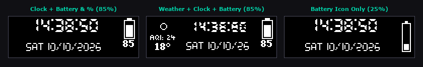
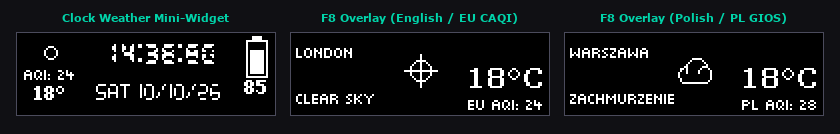
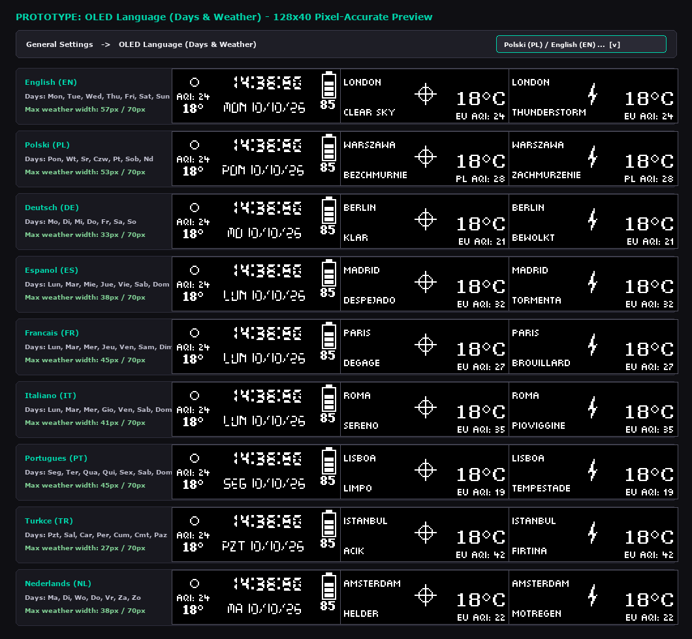

# 🎹 SteelSeries OLED & RGB Hub

**The ultimate music, hardware, weather, headset battery, and RGB ambiance dashboard for your SteelSeries Keyboard & Peripherals.**


-lightgrey?style=for-the-badge)


**SteelSeries OLED & RGB Hub** transforms your keyboard's 128×40 OLED screen and SteelSeries RGB peripherals into a unified, high-contrast information and lighting hub. Whether you're listening to Spotify or YouTube, watching Prime Video, tracking CPU/GPU temperatures and live FPS in-game, checking your wireless headset battery, or viewing local weather and multi-region Air Quality (`AQI`), SteelSeries OLED & RGB Hub delivers it with pixel-perfect clarity and zero flicker.

> [!NOTE]
> ### 💡 Inspiration & Project Heritage
> **SteelSeries OLED & RGB Hub (`v1.50`)** is **heavily inspired by the original [OLED Customizer](https://github.com/0z-zy/OLED_Customizer) created by [0z-zy](https://github.com/0z-zy)** (and the foundational [SteelSeries-Spotify-Linker](https://github.com/Firewee/SteelSeries-Spotify-Linker) by **[Firewee](https://github.com/Firewee)**).  
> It **retains and includes all features of the original application** (Spotify & Windows SMTC media dashboard, CPU/GPU/RAM/FPS Ghost-Monitor, adaptive volume control, Discord RPC & global mic mute, OLED calculator, 4 clock themes, and SteelSeries profile backups), while being significantly expanded by **[gizmous](https://github.com/Gizmous100)** with brand-new wireless headset battery telemetry, live weather & multi-region global AQI, 9-language OLED localization, smart AFK power-saving with gamepad detection, 10-zone mouse RGB & profile sync, and anti-jitter adaptive rendering.

---

## 📋 Table of Contents

- [🆕 Major New Features & Expansions (by gizmous)](#-major-new-features--expansions-by-gizmous)
  - [1. 🎧 Wireless Headset Battery & Native USB HID Telemetry](#1--wireless-headset-battery--native-usb-hid-telemetry)
  - [2. 🌦️ Live Weather & Multi-Region Air Quality Index (AQI)](#2-️-live-weather--multi-region-air-quality-index-aqi)
  - [3. 💤 Smart Idle / AFK Mode with XInput Gamepad Detection](#3--smart-idle--afk-mode-with-xinput-gamepad-detection)
  - [4. 🎮 Automatic Hardware Monitor Switching in Games](#4--automatic-hardware-monitor-switching-in-games)
  - [5. 🌈 10-Zone Mouse RGB & SteelSeries GG Profile Sync](#5--10-zone-mouse-rgb--steelseries-gg-profile-sync)
  - [6. 📐 Adaptive Clock Layouts, Anti-Jitter Digits & 9-Language OLED](#6--adaptive-clock-layouts-anti-jitter-digits--9-language-oled)
  - [7. 🎬 Streaming & Video Playback Hysteresis (Prime Video / Netflix)](#7--streaming--video-playback-hysteresis-prime-video--netflix)
  - [8. 🛡️ Fault-Tolerant Architecture & Stability Hardening](#8-️-fault-tolerant-architecture--stability-hardening)
- [📈 Version History (`v1.00` → `v1.50`)](#-version-history-v100--v150)
- [🚀 Complete Feature Overview](#-complete-feature-overview)
  - [🎵 Dynamic Media Dashboard](#-dynamic-media-dashboard)
  - [🌡️ Ghost-Monitor (Hardware Stats & FPS)](#️-ghost-monitor-hardware-stats--fps)
  - [🔊 Reimagined Volume Control & Discord Sync](#-reimagined-volume-control--discord-sync)
  - [🖩 Built-In OLED Calculator](#-built-in-oled-calculator)
  - [💾 SteelSeries Profile Backup & Database Compaction](#-steelseries-profile-backup--database-compaction)
- [⌨️ Global Hotkeys](#️-global-hotkeys)
- [🕰️ Clock Gallery](#-clock-gallery)
- [🛠️ Quick Setup & Building from Source](#️-quick-setup--building-from-source)
- [🎵 Spotify API Setup](#-spotify-api-setup)
- [🎙️ Discord RPC Setup](#️-discord-rpc-setup)
- [📦 Repository Structure](#-repository-structure)
- [📚 Acknowledgments & Credits](#-acknowledgments--credits)

---

## 🆕 Major New Features & Expansions (by gizmous)

Compared to the original OLED Customizer, **SteelSeries OLED & RGB Hub (`v1.49`)** introduces **4 major new functional modules (`+0.40`)** and **9 core architectural & UX upgrades (`+0.09`)**:

### 1. 🎧 Wireless Headset Battery & Native USB HID Telemetry
- **Direct USB HID Battery Readout**: Communicates directly with SteelSeries USB wireless transceivers via native Win32 HID reports (`[0x06, 0xb0]`) to read real-time battery levels for **SteelSeries Arctis Nova 7** (as well as compatible Cloud III / HyperX wireless headsets) without relying on heavy background services.
- **Vertical 4-Segment Battery Indicator**: Renders a crisp vertical 4-bar battery icon in the top-right corner of the clock display, with an optional numeric percentage (`0%`–`100%`) centered directly underneath.
- **Smart Power-Off & Range Detection**: Automatically detects when the wireless headset is powered off or out of range and hides the battery widget immediately so stale battery values are never displayed.



### 2. 🌦️ Live Weather & Multi-Region Air Quality Index (`AQI`)
- **Zero-API-Key Weather Engine**: Powered by Open-Meteo Geocoding, Weather Forecast, and Air Quality APIs — simply type your city name in **Settings → Display → Weather Widget** and save.
- **Configurable Global / Regional AQI Standards**: Choose your preferred Air Quality Index area/scale in Settings (**AQI Region / Standard**):
  - **`Auto (By City)`**: Automatically selects the matching regional AQI standard based on the geocoded country and timezone of your chosen city.
  - **`Europe (EU - CAQI)`**: European Environment Agency Common Air Quality Index (`0–100+`).
  - **`USA / Americas (US - EPA)`**: United States EPA Air Quality Index (`0–500`).
  - **`Poland (PL - GIOS)`**: Polish Chief Inspectorate of Environmental Protection (GIOS) scale calculated from live `PM2.5`, `PM10`, `NO₂`, `O₃`, and `SO₂` concentrations (`0–100+`).
  - **`United Kingdom (UK - DAQI)`**: UK DEFRA Daily Air Quality Index (`1–10`).
  - **`China (CN - MEP)`**: Chinese Ministry of Ecology and Environment (`HJ 633-2012`, `0–500`).
  - **`India (IN - NAQI)`**: Indian CPCB National Air Quality Index (`0–500`).
  - **`Canada (CA - AQHI)`**: Canadian Air Quality Health Index (`1–10+`).
  - **`Australia (AU - NEPM)`**: Australian National Environment Protection Measure AQI (`0–100+%`).
- **Clock Screen Weather Mini-Widget**: Displays a custom pixel-art weather condition icon (clear sky, clouds, drizzle/rain, snow, thunderstorm), live temperature (`°C`), and **`AQI`** on the left side of the clock screen.
- **Full-Screen Weather Overlay (`F8`)**: Press the Weather hotkey (default **`F8`**) at any time—even inside fullscreen games—to summon a dedicated full-screen weather card showing your city name, weather description, temperature, and regional `AQI` (e.g., `EU AQI: 24`, `US AQI: 46`, `PL AQI: 28`) for a configurable duration (default: 5 seconds).



### 3. 💤 Smart Idle / AFK Mode with XInput Gamepad Detection
- **OLED Burn-In Protection & RGB Blackout**: Automatically blanks the OLED display and turns off both keyboard and mouse RGB lighting after a configurable period of user inactivity (default: 5 minutes).
- **XInput Controller / Gamepad Awareness**: Continuously polls up to 4 connected XInput controllers (`XInputGetState`). When you are playing a game with a controller and not touching the keyboard or mouse, the app automatically resets the Windows idle timer (`VK_F15`) so your OLED screen and RGB lighting never turn off mid-game.
- **Instant Wake**: Restores the OLED display and your custom RGB color the instant keyboard, mouse, or controller input resumes.

### 4. 🎮 Automatic Hardware Monitor Switching in Games
- **Smart 3D Game Detection**: Enable *"Auto-switch to System Stats in Games"* in Settings to automatically switch the OLED screen from the clock to the live **CPU / GPU / RAM / FPS Hardware Monitor** whenever a 3D game is launched (detected via PresentMon telemetry).
- **Seamless Return**: Automatically switches back to your clock layout as soon as you exit the game.

### 5. 🌈 10-Zone Mouse RGB & Native SteelSeries GG Profile Coexistence
- **100% Native SteelSeries GG Engine Control (`release_lighting_to_gg`)**: During active usage, the app keeps the GameSense `LIGHTING` event unbound via `/remove_game_event` so **SteelSeries GG (Engine / Prism)** has 100% native control over your keyboard (**Apex 7**) and mouse (**Rival 5**) illumination configs, gradients, and multi-color effects—removing the legacy static *Match Keyboard Color* override that previously conflicted with GG profiles.
- **Full 10-Zone Mouse & Keyboard AFK Blackout (`rgb-zoned-device` + `rgb-per-key-zones`)**: When entering Idle / AFK mode, the app dynamically binds `LIGHTING` (`[0, 0, 0]`) across all **10 independent RGB mouse zones (`one` through `ten`)** and all keyboard keys, turning off all LEDs alongside the OLED display—and immediately releases control back to SteelSeries GG upon wake.
- **Transition-Only Lighting Dispatch**: Sends GameSense `LIGHTING` events strictly on AFK state transitions (entering/exiting idle) rather than inside the 10 FPS render loop—preventing HTTP 429 rate-limiting and mouse profile lockups.

### 6. 📐 Adaptive Clock Layouts, Anti-Jitter Digits & 9-Language OLED
- **Dynamic Horizontal Layout Fitting**: All 4 clock themes (*Standard*, *Big Timer*, *Date Focused*, and *Analog*) dynamically compute available horizontal space `[x_left .. x_right]` and automatically adjust font sizes and centering when the Weather widget (`38px` left) and/or Headset Battery widget (`19px`/`12px` right) are active. Tested across all widget/format combinations with zero pixel overlap.
- **Fixed-Width Anti-Jitter LCD Digits (`_draw_fixed_width_text`)**: Custom per-character cell rendering keeps the clock completely stationary when narrow digits (`1`, `4`) appear in the seconds counter.
- **9-Language OLED Support (`OLED Language (Days & Weather)`)**: Select between **9 popular languages** (`English (EN)`, `Polish (PL)`, `German (DE)`, `Spanish (ES)`, `French (FR)`, `Italian (IT)`, `Portuguese (PT)`, `Turkish (TR)`, and `Dutch (NL)`) in **Settings → Display → General Settings** to localize both Clock Day-of-Week abbreviations (e.g., `Pon, Wt, Sr, Czw, Pt, Sob, Nd` in Polish) and Full-Screen Weather Overlay (`F8`) condition descriptions (`Bezchmurnie`, `Zachmurzenie`, `Burza`, etc.), with automatic Unicode-to-ASCII transliteration for crisp pixel-font rendering.



### 7. 🎬 Streaming & Video Playback Hysteresis (Prime Video / Netflix)
- **2.5-Second Playback Grace Window**: Absorbs brief `Paused`/`Stopped` status blips from Windows UWP and browser video players (such as Amazon Prime Video, Netflix, and YouTube) so the OLED display never flickers between the media player and the clock.
- **Automatic Conflict Guard (`now-playing.exe`)**: Automatically suspends SteelSeries GG's conflicting built-in `now-playing.exe` applet while running (and resumes it on exit) to prevent competing OLED frame updates.

### 8. 🛡️ Fault-Tolerant Architecture & Stability Hardening
- **Bundled `sqlite3.dll` with Fallback Loader**: Ensures SteelSeries GG profile backups and database compaction (`VACUUM`) work reliably on any Windows installation.
- **Single-Instance & Memory Hardening**: Automatically cleans up orphaned background processes on startup, eliminates GDI/PIL image handle leaks in the 10 FPS loop, and fixes reopening the Settings GUI after saving.

---

## 📈 Version History (`v1.00` → `v1.50`)

> 📄 **For a complete, detailed description of all changes since the beginning of the project, see [`CHANGELOG.md`](CHANGELOG.md).**

| Version | Category | Summary of Changes |
| :--- | :---: | :--- |
| **`v1.00`** | Base | Original **OLED Customizer** foundation by **0z-zy** (inspired by **Firewee**). |
| **`v1.10`** | 🆕 Major (`+0.10`) | **Auto-Switch to Hardware Monitor in Games** via PresentMon FPS detection. |
| **`v1.20`** | 🆕 Major (`+0.10`) | **Wireless Headset Battery via USB HID** (`[0x06, 0xb0]`) + vertical 4-bar icon & power-off detection. |
| **`v1.30`** | 🆕 Major (`+0.10`) | **Live Weather & Air Quality (`AQI`) Module** (clock mini-widget + full-screen `F8` overlay). |
| **`v1.40`** | 🆕 Major (`+0.10`) | **Smart Idle / AFK Mode** (OLED & RGB blackout + XInput controller activity detection). |
| **`v1.41`** | ✨ Fix (`+0.01`) | **Compact Polish Day Names & Short Year** (`dd/mm/yy`) for side-widget compatibility. |
| **`v1.42`** | ✨ Fix (`+0.01`) | **Bundled `sqlite3.dll` Fault Tolerance** & thread-safe Settings window re-entry fix. |
| **`v1.43`** | ✨ Fix (`+0.01`) | **Fixed-Width Anti-Jitter Digits & Adaptive Clock Themes** across all 4 clock styles. |
| **`v1.44`** | ✨ Fix (`+0.01`) | **Memory, Threading & Single-Instance Hardening** (orphan process cleanup & PIL handle fixes). |
| **`v1.45`** | ✨ Fix (`+0.01`) | **SMTC / Prime Video Playback Hysteresis** (2.5s grace period & `now-playing.exe` suspension). |
| **`v1.46`** | ✨ Fix (`+0.01`) | **10-Zone Mouse RGB (`rgb-zoned-device`) & SteelSeries GG Config Switch Sync**. |
| **`v1.47`** | ✨ Fix (`+0.01`) | **Multi-Region / Global AQI Standards** (`Auto`, `EU CAQI`, `US EPA`, `Poland GIOS`, `UK DAQI`, `China MEP`, `India NAQI`, `Canada AQHI`, `Australia NEPM`). |
| **`v1.48`** | ✨ Fix (`+0.01`) | **9-Language OLED Support (Clock Days & Weather)** (`EN`, `PL`, `DE`, `ES`, `FR`, `IT`, `PT`, `TR`, `NL`) + localized geocoding & OLED visual previews. |
| **`v1.49`** | ✨ Fix (`+0.01`) | **Discord RPC Snowflake Validation, Setup Helpers & Initial Sync Fix**. |
| **`v1.50`** | ✨ Fix (`+0.01`) | **Native SteelSeries GG Config Lighting Coexistence & AFK Restore Fix**. |

---

## 🚀 Complete Feature Overview

### 🎵 Dynamic Media Dashboard
- **Spotify, YouTube & Streaming Support**: Real-time integration with Spotify (Web API), Windows media (SMTC), and browser playback.
- **5 Player Styles**: Choose between *Standard*, *Compact*, *Centered*, *Ticker*, and *Minimal* layouts.
- **Pixel-Perfect Icons**: Custom YouTube, Spotify, and Media icons crafted for the 128×40 OLED display.

| Spotify | YouTube | Generic Media |
| :---: | :---: | :---: |
|  |  |  |

### 🌡️ Ghost-Monitor (Hardware Stats & FPS)
- **Instant Peek (`Insert`)**: Tap **Insert** to summon CPU/GPU/RAM/FPS stats over any screen, toggle **Always Show System Stats**, or enable **Auto-Switch in Games**.
- **Thermal Guard & Memory Tracking**: High-accuracy CPU & GPU usage/temperature monitoring via LibreHardwareMonitor (with WMI fallback) plus live RAM usage.
- **🎮 Live Game FPS**: Real-time FPS counter powered by PresentMon (requires Administrator privileges).


### 🔊 Reimagined Volume Control & Discord Sync
- **Adaptive Volume Overlay**: Visual volume bar and dynamic speaker icons (mute, low, mid, high).
- **Discord RPC Sync & Global Mute**: Connects to Discord via local IPC to display microphone status on the clock and toggle mute globally via keyboard keys or mouse side buttons (`Mouse 4` / `Mouse 5`), plus physical headset mute button sync.


### 🖩 Built-In OLED Calculator
- **Quick Access (`Ctrl + Insert`)**: Open an interactive calculator directly on your keyboard's OLED screen. Captures numpad input so games don't receive stray keystrokes.

### 💾 SteelSeries Profile Backup & Database Compaction
- **One-Click Backups & Safety Restore**: Backup and restore your SteelSeries GG `engine`, `prism`, and `sonar` SQLite databases from the System Tray or **Settings → Backups**.
- **Compact Databases (`VACUUM`)**: Reclaim disk space from bloated SteelSeries databases.

---

## ⌨️ Global Hotkeys

| Action | Default Key | Notes |
| :--- | :--- | :--- |
| **Show System Stats** | `Insert` | Quick peek at CPU / GPU / RAM / FPS |
| **Show Weather Overlay** *(🆕 NEW)* | `F8` | Summons full-screen city weather & multi-region AQI |
| **Mute Microphone (Primary)** | `Pause` | Supports keyboard keys & mouse buttons (`M4` / `M5`) |
| **Mute Microphone (Optional)** | *Not set* | Bind a second mute key in Settings |
| **Toggle Calculator** | `Ctrl + Insert` | Numpad input, `Esc` to close |

---

## 🕰️ Clock Gallery

| Style | Preview |
| :--- | :---: |
| **Standard** |  |
| **Analog** |  |
| **Big Timer** |  |
| **Date Focused** |  |

---

## 🛠️ Quick Setup & Building from Source

> [!IMPORTANT]
> **Administrator Privileges**: Run the application as Administrator to enable hardware temperature sensors (LibreHardwareMonitor) and live game FPS (PresentMon). Enabling **"Run on Start"** automatically creates an elevated Windows Task Scheduler task.

### 1. Standalone Executable
1. Download **`SteelSeries-OLED-Hub.exe`** from [Releases](https://github.com/Gizmous100/SteelSeries-OLED-Hub/releases).
2. Launch `SteelSeries-OLED-Hub.exe` — the app will appear in your System Tray.
3. Right-click the tray icon and select **⚙️ Settings...** to customize your display, weather city, AQI region/standard, headset battery, hotkeys, and RGB color.

### 2. Running or Building from Source
```powershell
git clone https://github.com/Gizmous100/SteelSeries-OLED-Hub.git
cd SteelSeries-OLED-Hub
pip install -r requirements.txt

# Run from source:
python main.py

# Build standalone SteelSeries-OLED-Hub.exe:
python -m PyInstaller SteelSeries-OLED-Hub.spec --noconfirm
```

---

## 🎵 Spotify API Setup

Windows SMTC media detection works out of the box with zero configuration. If you also want direct Spotify Web API polling:
1. Visit the [Spotify Developer Dashboard](https://developer.spotify.com/dashboard) and click **"Create app"**.
2. Set **Redirect URI** to `http://127.0.0.1:2408/callback` and select **"Web API"**.
3. Copy your **Client ID** and **Client Secret** into **Settings → Spotify**, enable **Spotify Integration**, and click **SAVE**.

---

## 🎙️ Discord RPC Setup

To sync your Discord microphone mute/deafen state and toggle Discord mute via hotkeys or headset buttons:
1. Open the [Discord Developer Portal](https://discord.com/developers/applications) (or click **🌐 Developer Portal** in **Settings → Advanced**) and click **"New Application"**.
2. Open the **OAuth2** tab of your new application:
   - Copy **Client ID** (17–20 digit Snowflake number) and paste it into **Discord App ID** in **Settings → Advanced**.
   - Click **Reset Secret**, copy the generated secret, and paste it into **Discord Client Secret**.
   - Under **Redirects**, click **Add Redirect**, paste `http://127.0.0.1:8888` (or click **📋 Copy Redirect URI** in Settings), and click **Save Changes**.
3. Click **🔗 Connect Discord** in **Settings → Advanced** and click **Authorize** in the browser window.

---

## 📦 Repository Structure

```text
SteelSeries_OLED_Hub/
├── .gitignore                   # Git ignore rules for build/dist/cache files
├── CHANGELOG.md                 # Full version-by-version changelog (v1.00 -> v1.50)
├── LICENSE                      # MIT License (gizmous & original copyright 0z-zy / Firewee)
├── README.md                    # Project documentation
├── main.py                      # Application entry point & single-instance guard
├── version.py                   # Version (1.50) and author metadata
├── version_info.py              # Windows executable version metadata
├── SteelSeries-OLED-Hub.spec    # PyInstaller build specification
├── requirements.txt             # Python dependencies
├── sqlite3.dll                  # Bundled SQLite library for SteelSeries GG profile backups
├── content/                     # Icons, TrueType OLED fonts, documentation images & demo GIFs
└── src/                         # Application modules (DisplayManager, SteelSeriesAPI, Weather,
                                 # afk_monitor, HIDListener, Timer, WindowsMedia, HardwareMonitor,
                                 # fps_monitor, volume, Calculator, DiscordRPC, ProfileBackup, SettingsWindow, etc.)
```

---

## 📚 Acknowledgments & Credits

**SteelSeries OLED & RGB Hub (`v1.50`)** stands on the shoulders of great open-source projects and **includes all features of the original application** alongside major new expansions:

- **Author & Maintainer (`v1.50`)**: **[gizmous](https://github.com/Gizmous100)** — author of the `v1.10`–`v1.50` expansions (Wireless Headset Battery HID, Live Weather & Multi-Region Global AQI, 9-Language OLED Localization, Smart AFK + XInput Gamepad detection, Auto-Game Hardware Monitor, 10-Zone Mouse RGB & GG Config Sync, SMTC/Prime Video Hysteresis, and Adaptive Anti-Jitter Clock Layouts).
- **Original Application & Inspiration**: **[0z-zy](https://github.com/0z-zy)** — creator of the original [OLED Customizer](https://github.com/0z-zy/OLED_Customizer), which served as the direct inspiration and base for this project. All original features created by **0z-zy** are fully preserved in this edition.
- **Foundational Inspiration**: **[Firewee](https://github.com/Firewee)** — creator of [SteelSeries-Spotify-Linker](https://github.com/Firewee/SteelSeries-Spotify-Linker), whose core OLED & Spotify integration inspired the original project.

---

**Developed and Expanded by [gizmous](https://github.com/Gizmous100) (`v1.50`) • Includes all original features & heavily inspired by [OLED Customizer](https://github.com/0z-zy/OLED_Customizer) by [0z-zy](https://github.com/0z-zy) & [Firewee](https://github.com/Firewee).**
